# Landfall

**Move from Windows to Linux without losing anything, and without ever opening a terminal.**

Landfall is a free, open-source moving helper for people leaving Windows 10. Run it on your
Windows PC, plug in a USB drive, and it packs up your files, browser data, email, contacts,
Wi-Fi networks and more into one password-locked bundle. Plug that drive into your new Linux
PC, double-click Landfall, and everything lands where it belongs, with your apps installed.

It works with any Linux distro, and it only ever *reads* your Windows drive. It never changes
or repartitions anything.

> **Status: early development (v0.9).** Landfall can already check a Windows PC, let you pick
> Linux apps side by side, pack your files into a locked bundle, update the new Linux PC, and
> unpack everything with your apps installed. The rest of the list below is being built now.

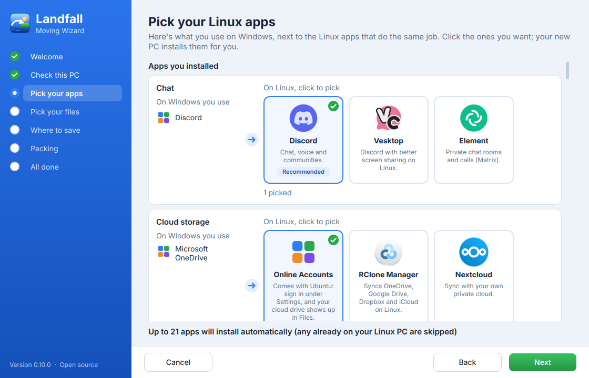

## What Landfall will move

| | What | Status |
|---|---|---|
| 🔍 | **Readiness report:** which apps and hardware will work on Linux | ✅ Working |
| 🎨 | **Friendly step-by-step wizard** with a modern, Windows-friendly look | ✅ Working |
| 🧩 | **Pick your Linux apps:** your Windows apps side by side with up to 5 Linux options each, real logos, 140 programs known | ✅ Working |
| 📁 | **Your files:** Desktop, Documents, Pictures, Downloads, Music, Videos, plus any folder or file you add, with "Choose..." to pick what's inside | ✅ Working |
| 🔄 | **"Let's update your PC first":** a full Linux system update, one password, no terminal | ✅ Working |
| 💡 | **Linux tips along the way** and a quick-start list at the end | ✅ Working |
| 🌐 | **Browsers:** bookmarks, history and passwords put straight into the browser you picked (Firefox fully automatic; Chrome, Edge and Brave passwords in one guided step) | ✅ Working |
| ✉️ | **Email and contacts:** Outlook and Thunderbird mail, Windows and Outlook contacts | Planned |
| 📶 | **Wi-Fi networks and passwords** | Planned |
| 🖼️ | **Personal touches:** wallpaper and fonts | Planned |
| 🎮 | **Game saves** | Planned |
| 🔑 | **Product keys and licenses list**, so you don't lose paid software | Planned |
| 📦 | **Apps:** matched Linux apps installed with one click | ✅ Working |

## Screenshots

**On Windows**

| | |
|---|---|
| 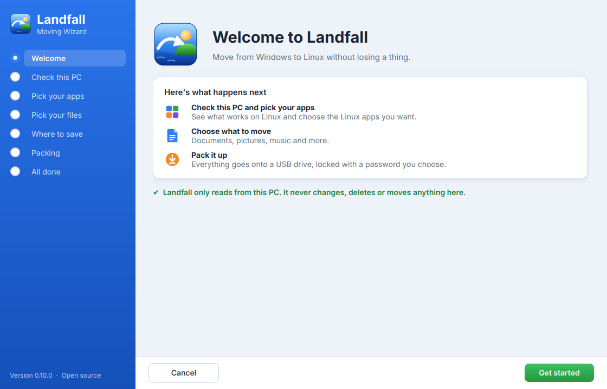 | 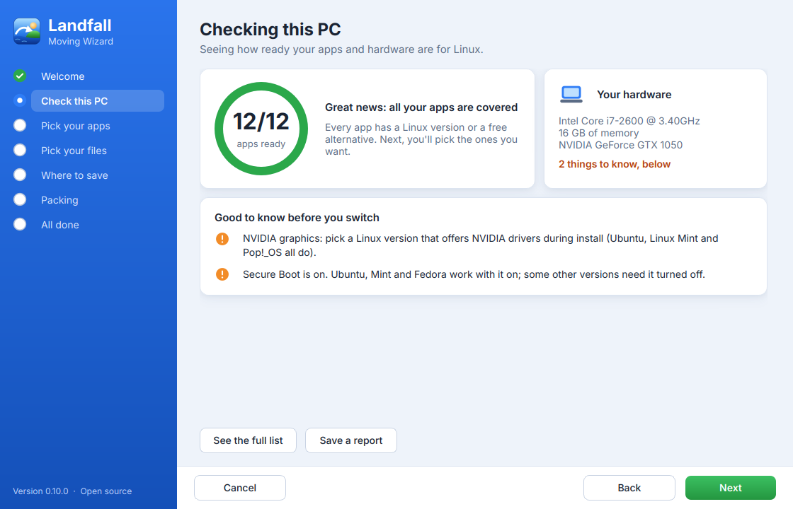 |
| **Welcome:** what's about to happen | **Check this PC:** how ready your apps and hardware are |
|  | 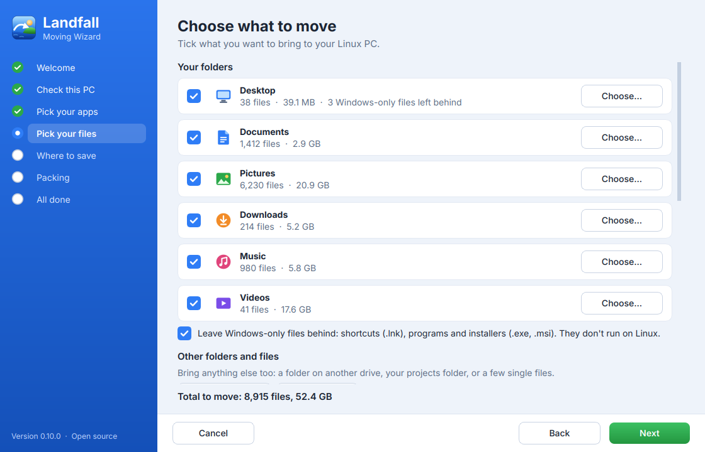 |
| **Pick your apps:** your Windows apps next to Linux options | **Pick your files:** folders, extra folders and single files |
| 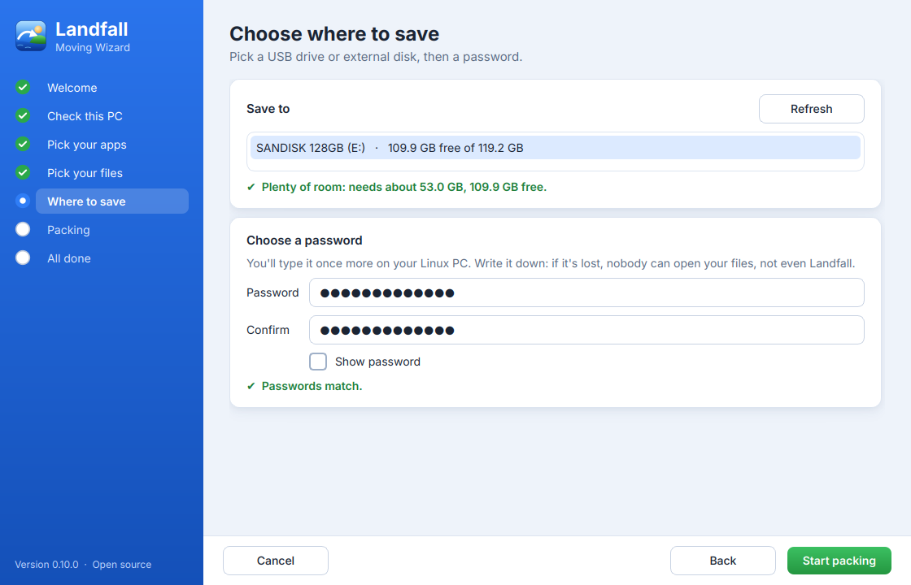 | 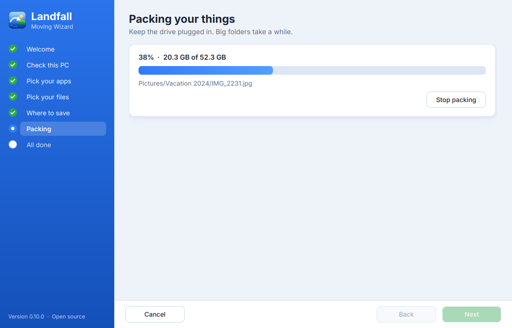 |
| **Where to save:** pick a USB drive and a password | **Packing:** everything locked into one bundle |
| 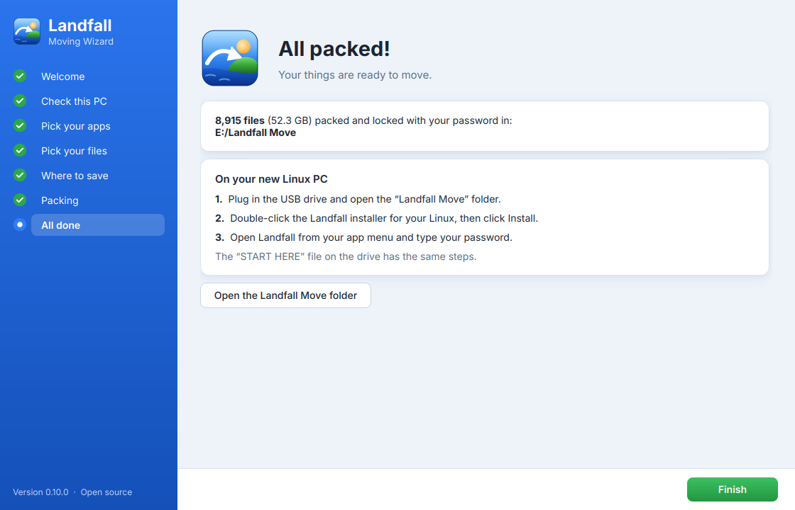 | |
| **All packed:** what to do on the new PC | |

**On Linux**

| | |
|---|---|
| 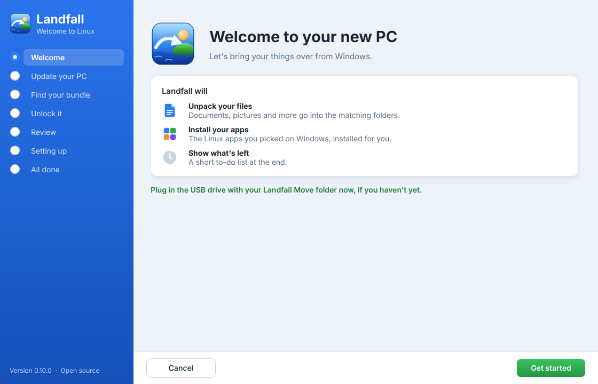 | 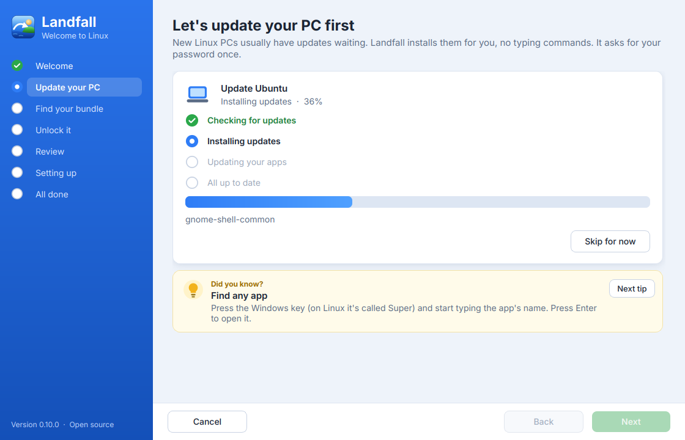 |
| **Welcome to your new PC** | **Let's update your PC first:** with tips while it works |
| 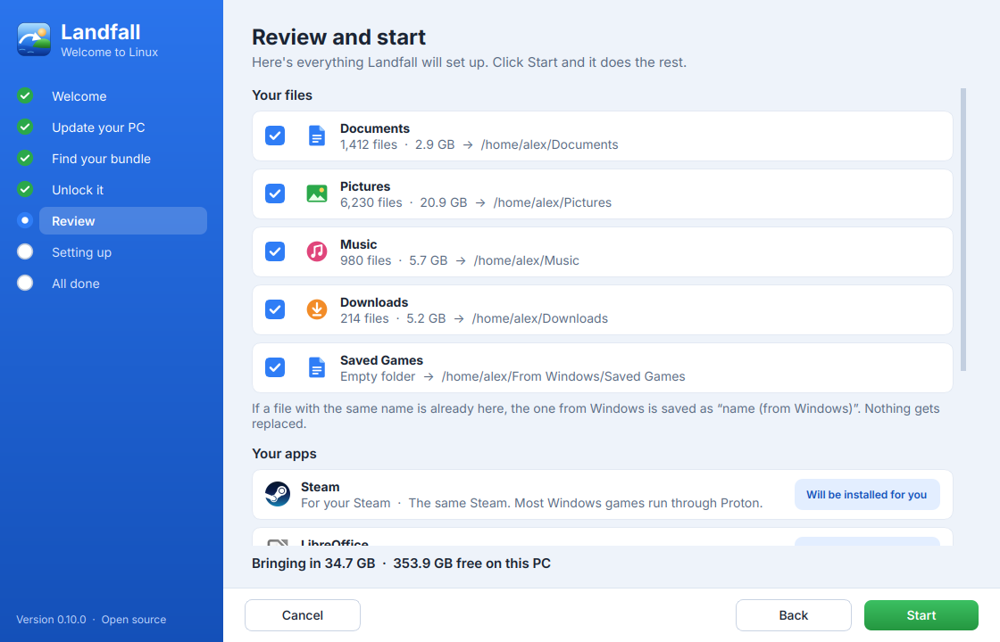 | 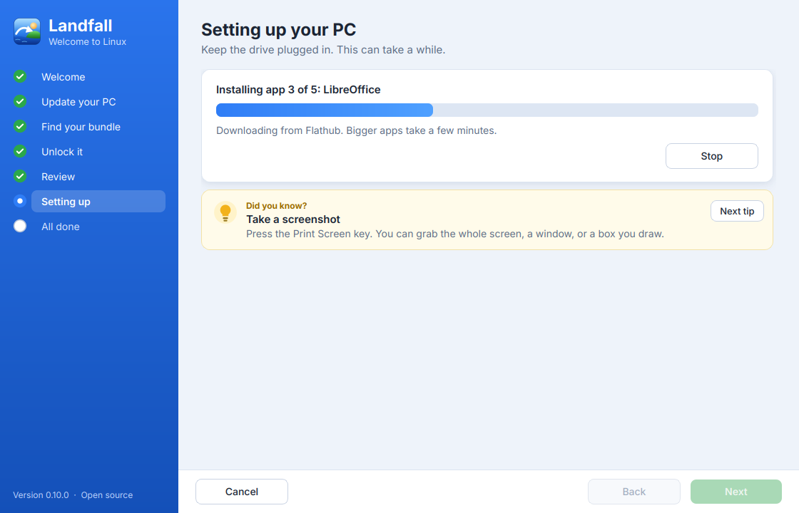 |
| **Review and start:** your files and apps, then one click | **Setting up:** unpacking files and installing apps |
| 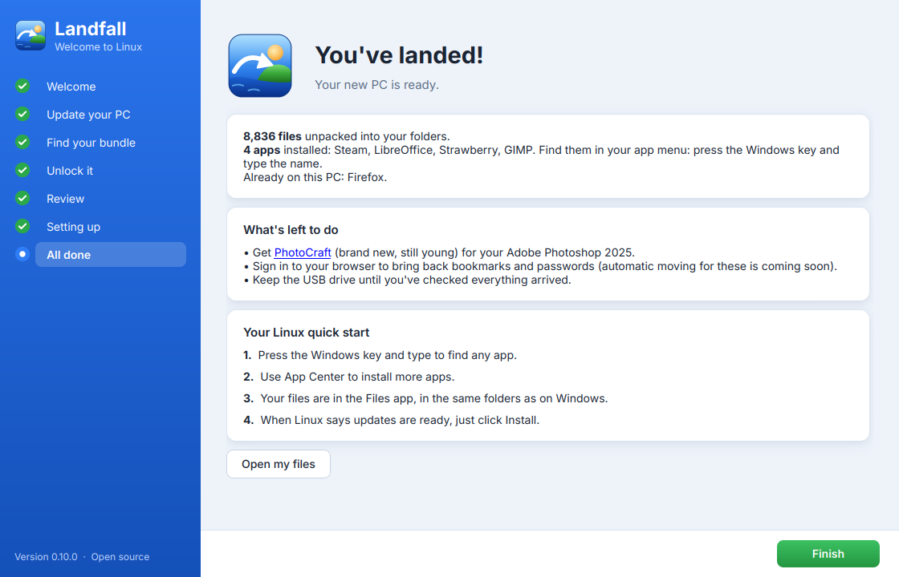 | 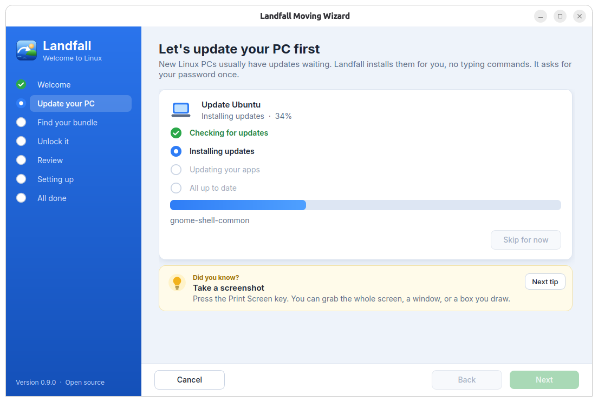 |
| **You've landed!** with a Linux quick start | **A real run** on a fresh Ubuntu 26.04 |

*Gallery screenshots use sample data; recreate them with `tools/make_screenshots.py`.*

## On the Linux side

- Double-click the Landfall installer on the USB drive (.deb for Ubuntu and Mint, .rpm for
  Fedora), click **Install**, then open Landfall from your app menu. No terminal, ever.
- Landfall first offers to update the whole system for you (one password, no terminal).
- Enter the bundle password you chose on Windows.
- Landfall puts your files in the matching folders, installs your apps, loads your bookmarks
  and contacts, connects your Wi-Fi and sets your wallpaper.
- You finish with a short "what's left to do" checklist.

## Safety first

- **Read-only on Windows:** Landfall never modifies, deletes or repartitions anything.
- **Encrypted:** passwords, browser data and email only travel inside an AES-256 bundle you
  can open with free 7-Zip.
- **No internet needed, no tracking:** Landfall has no network code and sends nothing anywhere.
- **No surprises:** see the bundle size before packing, check the USB has room, resume if
  unplugged, and verify every file arrived intact.

## Roadmap

- [x] Phase 0: Setup and build pipeline
- [x] Phase 1: Readiness report
- [ ] Phase 2: Wizard look, and packing everything into the encrypted bundle (files done)
- [ ] Phase 3: Linux importer (unpack, install apps, restore settings) (files and apps done)
- [ ] Phase 4: Public launch (v1.0)

## Run from source

```
python3 -m venv .venv
.venv/bin/pip install -r requirements-dev.txt
PYTHONPATH=src .venv/bin/python -m landfall
```

## License

GPL-3.0-or-later. See [LICENSE](LICENSE).
